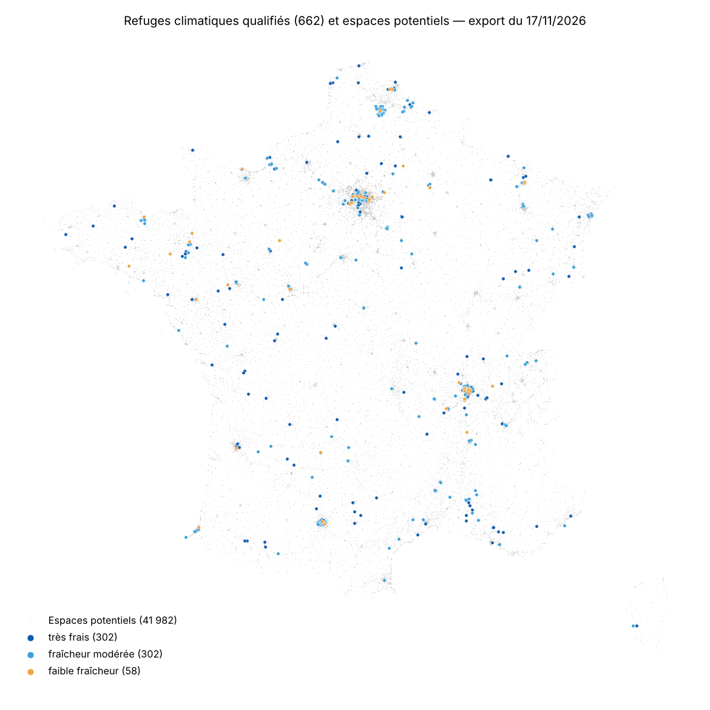

# Expérimentation : refuges climatiques sur cartes.gouv.fr

Ce dépôt sert d'expérimentation pour héberger la [cartographie collaborative des refuges climatiques](https://lesrefugesclimatiques.gogocarto.fr/) sur cartes.gouv.fr. Il contient :

- les données remises en forme ;
- une maquette de page catalogue au style cartes.gouv.fr (DSFR) ;
- les scripts qui régénèrent les deux à partir des exports GoGoCarto.

La carte d'origine est portée par TRIBU, avec un financement de l'ADEME (Appel à communs « Sobriété et résilience des territoires »). Toulouse Métropole en est le premier territoire test, et les laboratoires LISST et LMDC y participent.



## Contenu

| Chemin | Contenu |
| --- | --- |
| `donnees/refuges_climatiques_2026-11-17.gpkg` | GeoPackage normalisé, en WGS84, avec deux couches : `refuges_climatiques` (662 points, 45 attributs) et `espaces_refuges_potentiels` (42 411 points) |
| `donnees/refuges_climatiques_2026-11-17.csv` | Les 662 refuges en CSV, avec latitude et longitude |
| `donnees/doublons_*.csv` | Doublons probables à vérifier : entre refuges, et entre un refuge et un espace potentiel |
| `maquette/refuges_climatiques_maquette.html` | **Maquette autonome** : un seul fichier, à ouvrir par double-clic |
| `maquette/site/` | La même maquette, éclatée en plusieurs fichiers pour être servie par un serveur web |
| `maquette/src/` | Gabarit HTML et icônes DSFR de la maquette |
| `scripts/build_gpkg.py` | Construit le GeoPackage à partir des exports GoGoCarto |
| `scripts/build_maquette.py` | Génère les données de la maquette et la version autonome |
| `scripts/build_fond.js` | Génère le contour de secours `fond.json` à partir de Natural Earth |

Les exports bruts de GoGoCarto ne sont **pas** versionnés. Ils contiennent des colonnes de courriels (`email`, `userOwnerEmail`), que le GeoPackage exclut.

## La maquette

Elle prend la forme d'une fiche de jeu de données du catalogue cartes.gouv.fr, avec six onglets :

- **Carte** : les refuges colorés selon leur fraîcheur, des filtres, une fiche par lieu, et les espaces potentiels en couche optionnelle. Le fond est le Plan IGN ou les photographies aériennes de la Géoplateforme. Si les tuiles ne se chargent pas, la carte bascule sur un contour simple.
- **Tableau** : triable, export CSV.
- **Statistiques** : croissance de la base, répartitions.
- **Qualité** : liste des anomalies, avec les fiches concernées.
- **Contributions** : une file d'attente légère en attendant le guichet Espace collaboratif. Elle recueille les propositions de nouveaux refuges, les modifications, les signalements et les avis « c'est frais ». La file s'exporte en GeoJSON, avec les mêmes noms de champs que le GeoPackage.
- **À propos** : origine des données et feuille de route.

En local comme sur GitHub Pages, les contributions restent dans le navigateur, et il faut les exporter pour les transmettre.

### En ligne (GitHub Pages)

Le workflow `.github/workflows/pages.yml` publie `maquette/site/` à chaque push sur `main` qui touche ce dossier. La maquette est alors accessible à l'adresse <https://nicolasberthelot.github.io/expe-refuges-climatiques/>. La page porte une balise `noindex`, pour ne pas être référencée par les moteurs de recherche.

À la première mise en place : **Settings → Pages → Build and deployment → Source : GitHub Actions**.

### En local

Ouvrez `maquette/refuges_climatiques_maquette.html` par double-clic, ou servez la version éclatée :

```sh
cd maquette/site && python -m http.server 8000
```

## Régénérer à partir d'un nouvel export GoGoCarto

```sh
pip install pandas geopandas pyogrio scipy
python scripts/build_gpkg.py <export_refuges.csv> <export_tout.csv> donnees/refuges_climatiques_AAAA-MM-JJ.gpkg
python scripts/build_maquette.py donnees/refuges_climatiques_AAAA-MM-JJ.gpkg <export_tout.csv>
```

Ressources statiques de `maquette/site/`, à ne refaire qu'en cas de montée de version :

- `fonts.css` : Marianne 400, 500 et 700 en woff2, encodée en data URI, tirée de `@gouvfr/dsfr/dist/fonts/`.
- `maplibre-gl.css` : la feuille de style de `maplibre-gl@4.7.1`.
- `data/fond.json` : `npm i topojson-client world-atlas && node scripts/build_fond.js`.

## Modèle de données (couche `refuges_climatiques`)

| Bloc | Attributs |
| --- | --- |
| Identité | `nom`, `description`, `typologie`, `type_precision`, `categorie_potentiel` |
| Fraîcheur | `fraicheur_niveau` (valeur principale), `ressenti_fraicheur` (valeurs brutes) |
| Confort | `periode_matin`, `periode_apres_midi`, `periode_soir`, `ombrage` |
| Eau | `eau_etendue`, `eau_jeux`, `eau_fontaine`, `eau_potable` |
| Services | `service_enfants`, `service_assises`, `service_toilettes`, `service_gratuit`, `service_climatise` |
| Pratique | `accessibilite_pmr`, `autres_equipements`, `horaires_osm`, `horaires_precision`, `site_internet`, `telephone`, `image_url` |
| Adresse | `adresse`, `code_postal`, `commune` |
| Traçabilité | `id_source`, `source_import`, `id_ref_externe`, `osm_url`, `statut_source`, `moderation`, `date_creation`, `date_maj` |
| Contrôle | `qa_fraicheur_multiple`, `qa_ombrage_multiple`, `qa_geoloc_suspecte`, `qa_sans_adresse`, `qa_doublon_refuge`, `qa_doublon_potentiel`, `qa_sans_typologie` |

## Principaux constats sur l'export du 17/11/2026

- 662 refuges actifs, après retrait de 8 fiches supprimées ou doublons. La base comptait 96 fiches en novembre 2025, et les deux tiers des créations datent de juillet-août 2026.
- 36 fiches portent plusieurs niveaux de fraîcheur, 19 plusieurs niveaux d'ombrage, 76 n'ont pas de type d'espace, et 88 n'ont pas d'adresse.
- Une seule position est franchement erronée : le Lac de Beaulieu à Couëron (44) se retrouve dans les Vosges.
- On relève 3 paires de doublons probables entre refuges, et 20 refuges créés à côté de leur propre espace potentiel.

## Licences et réserves

- **Données** : TRIBU / ADEME, licence de diffusion encore à définir. Une partie des espaces potentiels provient d'OpenStreetMap, ce qui imposerait l'ODbL sur ces objets.
- **Code** du dépôt : à préciser.
- **Composants tiers** :
  - MapLibre GL JS : BSD-3-Clause ;
  - DSFR : MIT, sauf la police Marianne ;
  - police Marianne : réservée aux sites de l'État ;
  - Natural Earth : domaine public ;
  - fonds Plan IGN et photographies aériennes : IGN, Géoplateforme ;
  - découpage administratif : INSEE / Etalab.
- La maquette **n'est pas un service officiel**, et son en-tête n'utilise pas l'emblème de la République.
